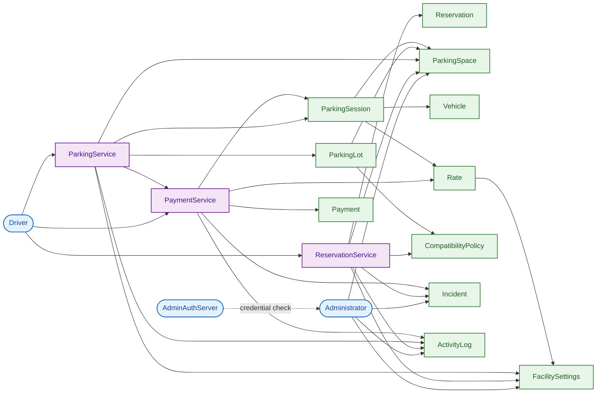

# 1.05 Sketch the Classes with CRC Cards

**Project:** Smart Parking Lot
**Owner:** Lead Developer, Backend Developer, Frontend Developer | **Points:** 3 | **Priority:** Must

**Sources used:** `docs/proposal.md` (section 8 suggested classes), `diagrams/SPLS_Class_Diagram.drawio`, `src/driver.js` (current domain logic), `src/Server.java` (admin login and sessions).

---

## How to read this document

Each card has three parts:

- **Class:** the name, and its one-sentence job.
- **Responsibilities:** what the class *knows* and what it *does*. All of them serve the one job.
- **Collaborators:** the other classes it must ask for help.

**🔌 Extension point** marks the place where a new type or rule slots in, and says how to add it without changing existing classes.

---

## 1. Changes from the project guide

The suggested classes come from the proposal (section 8). I compared them with the class diagram and the working prototype, then adjusted the list.

| Change | Class | Reason |
|---|---|---|
| Kept | `User`, `Driver`, `Administrator`, `Vehicle`, `ParkingLot`, `ParkingSpace`, `Reservation`, `ParkingSession`, `Rate`, `Payment`, `Incident` | They appear in both the proposal and the class diagram. |
| Kept, marked optional | `Attendant` | The proposal lists it as optional. The diagram and prototype do not use it, so it is deferred. |
| **Added** | `FacilitySettings` | The code already holds `maxSessionHours`, `reservationGraceMinutes`, `reservationsEnabled`, `expiryReminders` and the rates. They need one owner so they are configurable, as the proposal's maintainability requirement asks. |
| **Added** | `CompatibilityPolicy` | The vehicle-to-space matching rule is a hard-coded table in `isCompatible()`. A separate class gives new vehicle or space types one place to plug in. |
| **Added** | `ActivityLog` | The prototype records `state.activities` for the admin feed. This is a separate job from `Incident`. |
| **Added** | `ReservationService`, `ParkingService`, `PaymentService` | The proposal names them as coordinators. They keep workflow rules out of the data classes. |
| **Added** | `AdminAuthServer` (the existing `Server.java`) | It is the one class already implemented in Java, so it needs a card. |

**Not made into classes:** `Receipt` stays inside `Payment`. `Zone` and `Level` stay as a `level` field on `ParkingSpace`. Each has no behavior of its own yet.

---

## 2. Class list at a glance

| # | Class | One clear job |
|---|---|---|
| 1 | `User` (abstract) | Hold shared account details and sign-in. |
| 2 | `Driver` | Act for a person who parks. |
| 3 | `Administrator` | Act for staff who resolve exceptions. |
| 4 | `Attendant` *(optional)* | Give on-site help when automation fails. |
| 5 | `Vehicle` | Describe one vehicle (plate and type). |
| 6 | `ParkingLot` | Own the spaces and answer availability questions. |
| 7 | `ParkingSpace` | Track one space's type and status. |
| 8 | `CompatibilityPolicy` | Decide whether a vehicle type fits a space type. |
| 9 | `Reservation` | Hold a space for a driver for a time window. |
| 10 | `ParkingSession` | Record one stay, from entry to exit. |
| 11 | `Rate` | Turn a duration into a fee. |
| 12 | `Payment` | Record one payment attempt and its receipt. |
| 13 | `Incident` | Record one exception for review. |
| 14 | `FacilitySettings` | Store the configurable rules and limits. |
| 15 | `ActivityLog` | Keep the history feed of events. |
| 16 | `ReservationService` | Coordinate create, cancel, check-in and expiry of reservations. |
| 17 | `ParkingService` | Coordinate entry, time-limit checks and exit. |
| 18 | `PaymentService` | Coordinate fee calculation and payment. |
| 19 | `AdminAuthServer` | Serve pages and guard admin access. |

---

## 3. CRC cards

### Users

#### Card 1: `User` (abstract)

**Job:** Hold the account details shared by every role and let the person sign in.

| Responsibilities | Collaborators |
|---|---|
| Know `id`, `name`, `contact` | — |
| Sign in (`signIn()`) | `AdminAuthServer` (for admin accounts) |

> 🔌 **Extension point: new user role.** Add a subclass of `User` (for example `Attendant`). Nothing else changes. Each subclass supplies its own actions, which is the polymorphism the proposal calls for.

---

#### Card 2: `Driver` *(extends `User`)*

**Job:** Represent a person who parks, and start the driver's own actions.

| Responsibilities | Collaborators |
|---|---|
| Know their `vehicles` | `Vehicle` |
| Request a reservation for a vehicle type (`reserveSpace`) | `ReservationService` |
| Start a session when arriving (`checkIn`) | `ReservationService`, `ParkingService` |
| Pay for a finished stay (`pay`) | `PaymentService` |

---

#### Card 3: `Administrator` *(extends `User`)*

**Job:** Represent staff who investigate and correct exceptions.

| Responsibilities | Collaborators |
|---|---|
| Review open incidents (`reviewIncident`) | `Incident` |
| Close an incident with a note (`resolveIncident`) | `Incident`, `ActivityLog` |
| Change a space's status manually (`updateSpace`) | `ParkingSpace`, `ActivityLog` |
| Edit facility rules | `FacilitySettings` |

---

#### Card 4: `Attendant` *(extends `User`, optional, deferred)*

**Job:** Give on-site help when an automated step fails.

| Responsibilities | Collaborators |
|---|---|
| Assist a driver and refer the issue | `Incident`, `Driver` |

> Out of the first build. Add it later as a new `User` subclass; the other cards stay the same.

---

### Facility and spaces

#### Card 5: `Vehicle`

**Job:** Describe one vehicle so the system can match and price it.

| Responsibilities | Collaborators |
|---|---|
| Know `plate` and `type` (Standard, Motorcycle, EV, Accessible) | — |
| Know its owning `Driver` | `Driver` |

> 🔌 **Extension point: new vehicle type** (for example Truck). Add a value to `VehicleType`. Then add a row to `CompatibilityPolicy` and a price in `Rate`. No other class needs editing.

---

#### Card 6: `ParkingLot`

**Job:** Own the collection of spaces and answer "what is free for this vehicle?"

| Responsibilities | Collaborators |
|---|---|
| Know `name`, `levels` and the list of `spaces` | `ParkingSpace` |
| List available spaces for a vehicle type (`availableSpaces`) | `ParkingSpace`, `CompatibilityPolicy` |
| Pick a compatible free space (`assignSpace`) | `ParkingSpace`, `CompatibilityPolicy` |
| Report capacity and occupancy counts | `ParkingSpace` |

---

#### Card 7: `ParkingSpace`

**Job:** Track one space's type, level and status, and keep it from being double-booked.

| Responsibilities | Collaborators |
|---|---|
| Know `id`, `level`, `type`, `status` | — |
| Mark itself Reserved (`reserve`) | `Reservation` |
| Mark itself Occupied on entry | `ParkingSession` |
| Mark itself Available again (`release`) | `ParkingSession`, `Reservation` |
| Refuse a second active assignment | — |

**Statuses:** Available, Reserved, Occupied, Out of service.

> 🔌 **Extension point: new space type** (for example Loading Bay). Add a value to `SpaceType` and one entry in `CompatibilityPolicy`.
> 🔌 **Extension point: new space status** (for example Cleaning). Add a value to `SpaceStatus`. Define it in one place: whether it counts as "available".

---

#### Card 8: `CompatibilityPolicy`

**Job:** Answer one question: can this vehicle type use this space type?

| Responsibilities | Collaborators |
|---|---|
| Decide `isCompatible(vehicleType, spaceType)` | `Vehicle`, `ParkingSpace` |

**Current rules (from `driver.js`):**

| Vehicle type | Fits space types |
|---|---|
| Standard (car) | Standard, Accessible |
| Motorcycle | Motorcycle, Standard |
| EV | EV |
| Accessible | Accessible |

> 🔌 **Extension point: new vehicle or space rule.** This is the one place. Keep the rules as a table (data), not as `if/else` inside other classes. Today the same logic sits inside the page script, so moving it here is the first refactor.

---

### Booking and stay

#### Card 9: `Reservation`

**Job:** Hold one space for one driver for a time window.

| Responsibilities | Collaborators |
|---|---|
| Know `reference`, `driver`, `plate`, `vehicleType`, `space`, `arrivalAt`, `expiresAt`, `status` | — |
| Turn into a session when the driver arrives (`checkIn`) | `ParkingSession`, `ParkingSpace` |
| Cancel itself (`cancel`) | `ParkingSpace` |
| Mark itself Expired after the grace period | `FacilitySettings`, `Incident` |

**Statuses:** Reserved, Checked in, Completed, Cancelled, Expired.

> 🔌 **Extension point: new reservation rule** (for example a deposit, or a maximum advance booking time). Add the check in `ReservationService`, with the number kept in `FacilitySettings`. `Reservation` itself stays a record.

---

#### Card 10: `ParkingSession`

**Job:** Record one stay from entry to exit.

| Responsibilities | Collaborators |
|---|---|
| Know `vehicle`, `space`, `startedAt`, `endedAt`, `status`, `reservationReference` | `Vehicle`, `ParkingSpace` |
| Report elapsed time (`duration`) | — |
| Ask a `Rate` for the fee (`calculateFee`) | `Rate` |
| Close itself (`close`) | `ParkingSpace` |
| Remember whether a time-limit reminder was sent | — |

> 🔌 **Extension point: new session rule** (for example overstay penalty). Add it in `ParkingService`, with limits in `FacilitySettings`.

---

### Money

#### Card 11: `Rate`

**Job:** Turn a duration and vehicle type into a fee.

| Responsibilities | Collaborators |
|---|---|
| Know the hourly amount for a vehicle type | `FacilitySettings` |
| Calculate a fee (`calculate(duration)`) | — |

**Current rule (from `driver.js`):** charge by started hour, with a minimum of one hour. Defaults are ₱2.50 Standard, ₱1.25 Motorcycle and ₱3.50 EV per hour.

> 🔌 **Extension point: new pricing rule** (for example a daily cap, a free first 15 minutes, a peak-hour surcharge). Make `Rate` an interface with one `calculate(duration)` method. Each rule becomes its own implementation, and `ParkingSession` keeps calling `calculate`.

---

#### Card 12: `Payment`

**Job:** Record one payment attempt and its receipt.

| Responsibilities | Collaborators |
|---|---|
| Know `reference`, `amount` (₱), `method`, `status`, `paidAt` | — |
| Record the result, Paid or Failed (`recordResult`) | — |
| Produce a receipt (`receipt`) | — |
| Store no card or wallet credentials | — |

**Statuses:** Pending, Paid, Failed.

> 🔌 **Extension point: new payment method.** Add a value to `PaymentMethod` (current: Maya, PayPal, GCash, GoMo, cash, other e-wallet). For a real provider later, put it behind a `PaymentGateway` interface used by `PaymentService`, so `Payment` stays unchanged.

---

### Exceptions and records

#### Card 13: `Incident`

**Job:** Record one exception that needs a human decision.

| Responsibilities | Collaborators |
|---|---|
| Know `id`, `type`, `details`, `space`, `status`, `createdAt`, `resolution` | — |
| Close itself with a note (`resolve`) | `Administrator` |

**Current types:** Reservation expired, Reservation exception, Failed payment.

> 🔌 **Extension point: new incident type** (for example wrong-space parking, overstay). Add a type value, and have the service that detects it create the `Incident`. `Incident` does not change.

---

#### Card 14: `FacilitySettings`

**Job:** Store the rules and limits that must be configurable, not hard-coded.

| Responsibilities | Collaborators |
|---|---|
| Know hourly `rates` per vehicle type | `Rate` |
| Know `maxSessionHours`, `reservationGraceMinutes` | `ParkingService`, `ReservationService` |
| Know `reservationsEnabled`, `expiryReminders` | `ReservationService`, `ParkingService` |
| Be edited by an administrator | `Administrator` |

> 🔌 **Extension point: any new tunable number or switch.** Add it here, never inside another class. This is how the proposal's "configurable rather than embedded in logic" requirement is met.

---

#### Card 15: `ActivityLog`

**Job:** Keep the readable history of what happened.

| Responsibilities | Collaborators |
|---|---|
| Add an entry (icon, text, time) | — |
| Return recent entries for the admin feed | `Administrator` |

---

### Coordinators

#### Card 16: `ReservationService`

**Job:** Run the reservation workflow from request to expiry.

| Responsibilities | Collaborators |
|---|---|
| Check reservations are enabled, and the space is free and compatible | `FacilitySettings`, `ParkingSpace`, `CompatibilityPolicy` |
| Create a reservation and reserve the space | `Reservation`, `ParkingSpace` |
| Cancel a reservation and free the space | `Reservation`, `ParkingSpace` |
| Verify a reservation at check-in; open an incident if it fails | `Reservation`, `Incident` |
| Expire late reservations after the grace period | `Reservation`, `FacilitySettings`, `Incident` |
| Log each action | `ActivityLog` |

---

#### Card 17: `ParkingService`

**Job:** Run the parking workflow from entry to exit.

| Responsibilities | Collaborators |
|---|---|
| Start a session on an entry event; mark the space Occupied | `ParkingSession`, `ParkingSpace` |
| Assign a compatible space to a walk-in vehicle | `ParkingLot` |
| Send a reminder before the time limit | `ParkingSession`, `FacilitySettings`, `ActivityLog` |
| Handle an exit event: ask for payment, then close the session and release the space | `PaymentService`, `ParkingSession`, `ParkingSpace` |

> 🔌 **Extension point: new entry or exit source** (a sensor, a gate, license-plate reading). Feed the same entry and exit events into this class. The prototype's simulated check-in is just one source.

---

#### Card 18: `PaymentService`

**Job:** Turn a finished session into a recorded payment and receipt.

| Responsibilities | Collaborators |
|---|---|
| Compute the amount due | `ParkingSession`, `Rate` |
| Create a `Payment` and record its result | `Payment` |
| On failure, keep the session open and open an incident | `ParkingSession`, `Incident` |
| On retry success, resolve that incident | `Incident` |
| Log each payment | `ActivityLog` |

---

### Server

#### Card 19: `AdminAuthServer` (the existing `Server.java`)

**Job:** Serve the site and decide whether a request may see the admin page.

| Responsibilities | Collaborators |
|---|---|
| Serve the allowed static files | — |
| Check admin credentials (`login`) | `User` / `Administrator` |
| Create, check and end admin sessions (`isAuthenticated`, `logout`) | — |
| Redirect unauthenticated admin requests to the login page | — |

> **Note:** Today it knows only one demo admin from environment variables. Parking data lives in the browser's `localStorage`, not in Java objects. Moving the domain classes server-side is a later step, not part of this task.

---
## 4. Collaboration map

Arrows represent **"uses / depends on"** relationships across the Smart Parking Lot System (`SPLS`).

### Collaboration Summary by Layer

| Layer | Class / Actor | Collaborators | Role in Flow |
| :--- | :--- | :--- | :--- |
| **Actors & Auth** | `Driver` | `ReservationService`, `ParkingService`, `PaymentService` | Initiates bookings, check-ins/outs, and payments |
| | `Administrator` | `Incident`, `ParkingSpace`, `FacilitySettings`, `ActivityLog` | Manages facility rules, space overrides, incidents, and audit logs |
| | `AdminAuthServer` | `User / Administrator` | Validates staff credentials for `admin.html` access[cite: 1] |
| **Services** | `ReservationService` | `Reservation`, `ParkingSpace`, `CompatibilityPolicy`, `FacilitySettings`, `Incident`, `ActivityLog` | Validates vehicle fit, books/cancels reservations, logs actions |
| | `ParkingService` | `ParkingSession`, `ParkingSpace`, `ParkingLot`, `FacilitySettings`, `PaymentService`, `ActivityLog` | Handles live entry/exit, space allocation, and triggers checkout billing |
| | `PaymentService` | `ParkingSession`, `Rate`, `Payment`, `Incident`, `ActivityLog` | Calculates fees, records transactions, and flags billing issues |
| **Domain & Config** | `ParkingLot` | `ParkingSpace`, `CompatibilityPolicy` | Aggregates spaces and enforces lot-wide vehicle compatibility |
| | `ParkingSession` | `Rate`, `ParkingSpace`, `Vehicle` | Tracks active stay duration, assigned space, and applicable rate |
| | `Rate` | `FacilitySettings` | Applies base/hourly pricing and grace-period rules |

---
## 5. Where new types and rules slot in

| To add… | Change this | Everything else stays |
|---|---|---|
| A new **user role** | New subclass of `User` | ✔ |
| A new **vehicle type** | `VehicleType` value, one row in `CompatibilityPolicy`, one price in `FacilitySettings`/`Rate` | ✔ |
| A new **space type** | `SpaceType` value, one entry in `CompatibilityPolicy` | ✔ |
| A new **space status** | `SpaceStatus` value, and whether it counts as available | ✔ |
| A new **pricing rule** | New implementation of `Rate` | ✔ |
| A new **payment method** | `PaymentMethod` value (real provider: `PaymentGateway` behind `PaymentService`) | ✔ |
| A new **incident type** | Type value, raised by the service that detects it | ✔ |
| A new **reservation or session rule** | Check in `ReservationService` / `ParkingService`, number in `FacilitySettings` | ✔ |
| A new **entry/exit source** (sensor, gate) | Send events to `ParkingService` | ✔ |
| A new **tunable setting** | `FacilitySettings` | ✔ |

---

